# Swasthya Sahayak: 10-Day Language Integration Plan (Khasi, Garo, & Ladakhi)

This document outlines the detailed timeline, day-by-day task breakdown, and technical rationale for integrating Khasi and Garo (for Meghalaya) and Ladakhi (in both Tibetan Script and Wylie Transliteration for Ladakh) into the **Swasthya Sahayak** medical triage chatbot.

---

## 1. Executive Summary & Project Objectives

The primary goal of this expansion is to extend the accessibility of Swasthya Sahayak to regional users in Meghalaya and Ladakh. 
* **Meghalaya Integration:** Addition of Khasi and Garo languages.
* **Ladakh Integration:** Addition of Ladakhi, supporting both native Tibetan script (for local display and input) and Wylie transliteration (a standard romanized system used for keyboard input and academic/digital communication).

The total duration of this project is estimated at **10 business days**, which includes backend pipeline modification, frontend integration, fallback translation proxy development, linguistic verification, and end-to-end safety validation.

---

## 2. Technical Rationale: Why 10 Days?

Integrating low-resource regional languages into an AI-powered medical assistant introduces unique technical challenges that require a longer development and verification timeline compared to standard languages (e.g., Hindi, Tamil):

1. **Lack of Direct API Support in Voice/Translation Platforms:**
   Commercial state-of-the-art regional voice and translation engines (such as Sarvam AI's Saaras and Bulbul models) only support the 22 Scheduled Languages of India. Khasi, Garo, and Ladakhi are not currently supported. Integrating them requires:
   * Developing a **custom translation proxy** on the backend using Bedrock's Llama 3 70B model to handle text translations dynamically.
   * Designing strict prompts to ensure batch translations using specific syntax delimiters (e.g., `~~~~`) return exactly matched array structures.
   * Implementing graceful **voice service fallbacks** on the frontend, disabling microphone and speaker capabilities for unsupported languages while displaying user-friendly guidance.

2. **Multi-Script Support for Ladakhi:**
   Ladakhi has two common written forms in digital interfaces: native Tibetan script (using tall unicode characters) and Wylie transliteration (using standard Latin characters to represent Tibetan sounds). We must support both scripts, which doubles the prompt engineering, layout verification, and dictionary overhead for Ladakh.

3. **Linguistic Layout & Font Verification:**
   Tibetan script is highly vertically oriented and has different spacing requirements than Latin or Devanagari scripts. This requires manual CSS overrides and testing across device aspect ratios to prevent text overlapping or clipping on mobile interfaces.

4. **Medical Triage Safety & Prompt Calibration:**
   Because this is a first-aid assistant, accurate symptom extraction (`extract_symptoms`) and emergency classification (`classify_emergency`) are safety-critical. Low-resource languages are prone to translation shifts. We must carefully update system prompts, add few-shot detection examples, and run diagnostic regression tests to guarantee that triage accuracy does not degrade.

---

## 3. Day-by-Day Implementation Breakdown

```mermaid
gantt
    title Swasthya Sahayak 10-Day Integration Timeline
    dateFormat  X
    axisFormat %d
    
    section Research & Planning
    Day 1 - Requirements & Scripts      :active, 0, 1
    Day 2 - Extraction & Prompt Tuning  : 1, 2
    
    section Core Development
    Day 3 - Frontend UI & State Mapping : 2, 3
    Day 4 - Custom Translation Endpoints: 3, 4
    Day 5 - Onboarding Localizations    : 4, 5
    
    section Fallbacks & System Integr.
    Day 6 - Voice Fallbacks & CSS       : 5, 6
    Day 7 - LangGraph Node Integrations  : 6, 7
    
    section Quality & Verification
    Day 8 - End-to-End Triage Testing   : 7, 8
    Day 9 - Linguistic Review & QA      : 8, 9
    Day 10 - Staging Deploy & Handover   : 9, 10
```

### **Phase 1: Research, Design, and Prompt Tuning (Days 1–2)**

#### **Day 1: Requirements Gathering & Character Verification**
* **Linguistic Alignment:** Establish the vocabulary boundaries for medical terms in Khasi, Garo, and Ladakhi. Determine native name representations for user interface drop-downs.
* **Font and Render Checking:** Test Unicode font stacks for Tibetan script rendering on targeted platforms (iOS, Android, Chrome/Safari web engines). Check for diacritical markers used in Garo and Khasi.
* **Fallback Rules Mapping:** Document specific error codes and fail-soft behavior when backend translation APIs exhibit high latency.

#### **Day 2: Base UI String Extraction & LLM Prompt Calibration**
* **String Extraction:** Gather all localized user interface elements from onboarding, setup forms, and error panels.
* **LLM Prompts Tuning:** Refine the Llama 3 70B system instructions in `api.py` to add translation few-shots for Khasi, Garo, and Ladakhi.
* **Delimiter Constraints Development:** Write prompt schemas enforcing the preservation of the `~~~~` separator in batch translations, preventing array mismatch issues in the React application.

---

### **Phase 2: Frontend & Translation Pipeline Development (Days 3–5)**

#### **Day 3: Frontend Dropdowns & State/Region Mapping**
* **State Config Upgrades:** Modify language configuration tables in the frontend (`Navbar.tsx` and `ChatInterface.tsx`) to register `kha-IN` (Khasi), `grt-IN` (Garo), `lbj-IN` (Ladakhi - Tibetan), and `lbj-WY` (Ladakhi - Wylie).
* **Setup Screen Extension:** Introduce a localized region selection mechanism to prioritize regional dialects based on geographic proximity.

#### **Day 4: Custom Backend Translation Endpoints**
* **Translation Service Implementation:** Add a new secure `/translate` endpoint to `api.py` powered by Llama 3 to intercept and translate text blocks on the fly.
* **Translation Router Integration:** Update frontend `api.ts` to implement a translation router, checking language codes and proxying regional low-resource languages to our backend, while routing standard languages directly to the high-performance Sarvam API.

#### **Day 5: Static Localization Tables (Onboarding Agreement)**
* **Onboarding Translations:** Compile static translations for the legal disclaimer, emergency instructions, and guideline headers in the four new language/script variants.
* **Data Store Implementation:** Integrate these localizations into the onboarding file `ImportantInformation.tsx` to eliminate load-time flickering and translation delays for regional users.

---

### **Phase 3: Fallbacks, Integration, & Verification (Days 6–8)**

#### **Day 6: Voice-to-Text & Text-to-Speech Fallbacks & CSS Layouts**
* **Voice Toggle Implementation:** Implement automatic feature toggles inside `ChatInterface.tsx` to disable microphone (STT) and speaker (TTS) buttons when low-resource languages are active. Add visual tooltips explaining the keyboard focus.
* **Tibetan UI Alignment:** Write tailored CSS rule overrides to increase vertical leading (line-height) and line spacing for Tibetan unicode scripts, ensuring characters do not overlap.

#### **Day 7: LangGraph Pipeline Integration & Language Detection Upgrades**
* **Language Detection Node Tuning:** Update the backend `detect_language` graph node in `api.py` to identify Khasi, Garo, and Ladakhi input texts.
* **LangGraph Integration:** Connect the newly added state properties to the SQLite database schema to ensure seamless chat history recovery and session tracking.

#### **Day 8: Automated Verification & Medical Triage Safety Review**
* **Triage Regression Tests:** Run standard test suites through the triage graph to verify that symptom extraction (`extract_symptoms`) and emergency classification (`classify_emergency`) function correctly for queries submitted in Khasi, Garo, and Ladakhi.
* **Separator Validation:** Run stress tests on batch translations to ensure separators are never mangled by the custom LLM translation proxy.

---

### **Phase 4: Review, Bug Fixing, & Handover (Days 9–10)**

#### **Day 9: Linguistic Verification & Layout Refinements**
* **Translation Quality Review:** Manually review LLM responses in Khasi, Garo, and Ladakhi to check for mixing of standard Hindi/English terms and correct dialect usage.
* **UI Stress Testing:** Conduct layout checks on devices with smaller viewport widths (e.g., iPhone SE, budget Android phones) to verify script readability and layout integrity.

#### **Day 10: Staging Deployment, Final Documentation & Client Handoff**
* **Staging Push:** Deploy the updated backend and frontend components to the staging environment.
* **Documentation & Handoff:** Complete the developer API notes. Deliver the final application code and handover reports to the client's internal team.

---

## 4. Summary of Deliverables

At the end of the 10-day period, the client will receive:
1. **Updated Backend (`api.py`):** Incorporating the Llama 3 translation proxy, updated language detection nodes, and updated database tracking.
2. **Updated Frontend Components:**
   - Modified `Navbar.tsx` and `ChatInterface.tsx` with language definitions.
   - Graceful voice-fallback mechanics and customized Tibetan CSS layouts.
   - Fully translated static strings in `ImportantInformation.tsx`.
3. **Automated Test Logs:** Proving correct triage routing and separator stability.
4. **Final Integration Documentation:** Detailed endpoint usage and configuration instructions.
